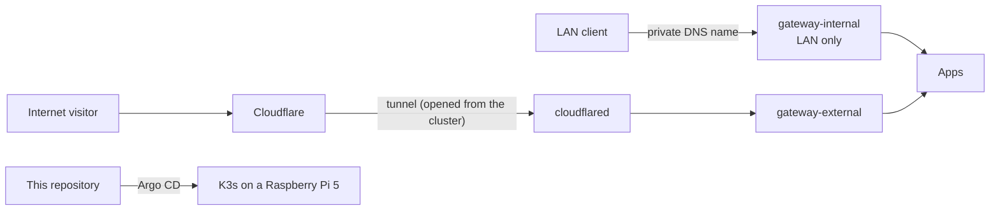

# k3s-gitops: a single-node Raspberry Pi 5 Kubernetes cluster, built by hand and then run from Git

A single-node [K3s](https://k3s.io/) cluster on a Raspberry Pi 5, with its networking, certificates, public access and deployments all described in this repository. It comes with a step-by-step guide that takes a reader from an empty Pi to a working cluster, one verified chapter at a time.

The approach is simple: **build each part by hand and check it works, then hand it to Argo CD.** One change at a time makes a failure easy to find, and the guide shows the real output of every check.

## What is running

|Layer|Choice|What it does|
|---|---|---|
|Kubernetes|K3s `v1.35.10+k3s1`|A small, real Kubernetes on one Pi 5 (Ubuntu Server 24.04.5 LTS). Its bundled network plugin, kube-proxy, load balancer, ingress and storage are turned off on purpose, so each is replaced|
|Networking|Cilium `1.20.4`|Pod networking, replaces kube-proxy, gives `LoadBalancer` services addresses on the home network, and implements the Gateway API|
|Entry points|Gateway API `v1.6.3`|Two Gateways: one reachable only from the LAN, one for chosen public apps|
|Certificates|cert-manager `v1.21.2`|Let's Encrypt wildcard certificate using the DNS challenge, so no inbound ports are needed|
|Public access|Cloudflare Tunnel (`cloudflared` `2026.10.7`)|Public apps are reached through an outbound connection from the cluster. No router port forwarding. One DNS record per public app, no wildcard record|
|Storage|OpenEBS `4.6.0` (hostpath) and csi-driver-nfs `v4.13.4`|Local volumes for disposable data. NFS volumes on a NAS, with `Retain`, for data that should survive a rebuild|
|GitOps|Argo CD `v3.4.6` (chart `10.2.2`)|Applies this repository to the cluster and manages itself|
|Workstation|Dev container (kubectl 1.35, Helm 4.3.1, Kustomize `v5.8.1`)|Every command in the guide runs in the same container, so the tools match the guide|

The versions are deliberately supported but not the newest, so that upgrading the cluster can be practised once the build is done.

## How the pieces fit



A name is public only when three separate things exist: a Cloudflare DNS record, a rule in the tunnel's configuration, and an `HTTPRoute` on the external Gateway. A private app never attaches to the external Gateway.

## How Argo CD is used

- **Infrastructure** (cert-manager, the Gateway, the tunnel, storage, Argo CD itself): one hand-written Application per folder, **manual sync**, no automatic pruning. Networking, certificates and storage are risky, so a person presses sync.
- **Apps**: one ApplicationSet watches the `apps/` folder. A new folder there becomes an Application by itself, with automatic sync and self-heal, and with pruning off.
- **Kept outside Argo CD, on purpose:** Cilium and its address pool (a mistake there cuts the cluster off from the network), the Gateway API definitions, and the Secrets.

## Repository layout

```
k3s-gitops/
├── .devcontainer/        # dev container: the tools the guide uses
├── infra/
│   ├── cilium/           # Helm values, installed by hand (outside Argo CD)
│   ├── cilium-config/    # address pool and layer 2 policy (outside Argo CD)
│   ├── storage/          # openebs/ and csi-driver-nfs/
│   ├── cert-manager/     # the controller
│   ├── cert-manager-config/  # the certificate issuers
│   ├── gateway/          # the two Gateways and the wildcard certificate
│   ├── cloudflared/      # the tunnel
│   └── argocd/           # Argo CD, its Applications and the apps ApplicationSet
└── apps/
    └── hello/            # the first test app
```

Downloaded Helm charts (`infra/**/charts/`) are not committed.

## Status

|Part|State|
|---|---|
|Planning, workstation and dev container, Raspberry Pi preparation|Built and run on a Pi 5|
|K3s, Cilium, storage, cert-manager, Gateway and first app, Cloudflare Tunnel|Built and run. A public test page loaded from a phone on mobile data|
|Argo CD|Built and run. Eight Applications are `Synced` and `Healthy`|
|More apps (nginx, a dashboard, SearXNG), DNS and troubleshooting, maintenance and backup, a worker node, teardown and rebuild, the upgrade document|Planned|
|Monitoring (Prometheus, Grafana, Alertmanager)|Planned, and last, because of the memory limits of one Pi|

Known limits of the current build:

- Certificates are Let's Encrypt **staging** certificates for now. The switch to production, and the removal of the temporary `noTLSVerify` setting in the tunnel, is the last step of the guide.
- The public test page has no login. Put Cloudflare Access in front of anything real before publishing it.

## The guide

The guide is a set of Markdown chapters. Every chapter has the same four parts: **Why** (the idea in plain words), **Steps** (exact commands), **Checkpoint** (how to prove it worked) and **If it fails** (a troubleshooting table). Output copied from a real run is marked as real, with the date. Anything not yet run is marked **Reconstructed**.

Chapters, in order: Start here, Planning and accounts, Workstation and dev container setup, Prepare the Raspberry Pis, Install K3s and connect kubectl, Cilium, Storage, cert-manager and HTTPS certificates, Gateway and your first app, Cloudflare Tunnel, Argo CD. Appendices: example files filled in, Hubble relay and UI, Raspberry Pi LED behaviour, remove the dev container, version compatibility and sources.

## Screenshots

<!-- Add before publishing: 1. The Argo CD Applications page showing all eight Applications Synced and Healthy. 2. The public test page loaded from a phone on mobile data. 3. A terminal with `kubectl get nodes` and `kubectl get pods -A`. -->

## Security

- No secret is in this repository: no API tokens, tunnel credentials, `cert.pem`, kubeconfig or passwords. The `.gitignore` excludes them.
- Secrets are created with `kubectl` and are not managed by Argo CD. A rebuild means creating them again.
- Exposing a home cluster to the internet carries risk. Cloudflare terminates the traffic and can see it. Only chosen apps are published, one DNS record each.

## Credit

The design follows [`mitchross/k3s-argocd-starter`](https://github.com/mitchross/k3s-argocd-starter), used for reading only. This repository's own licence: **to be chosen.**
